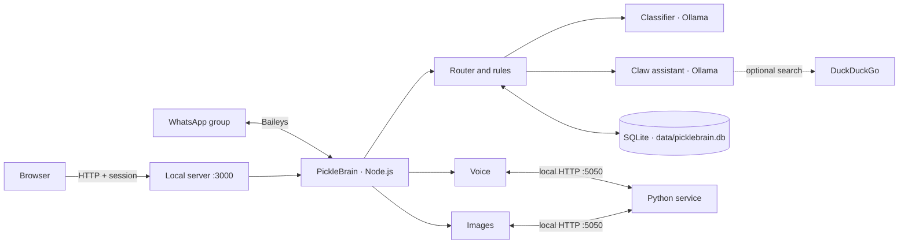

# Architecture

Claw is three pieces that can run on the same computer:

1. **PickleBrain** (`npm start`): the Node.js process that holds the WhatsApp session, decides what to do with each message, talks to Ollama and stores everything in SQLite.
2. **Python service** (`npm run ia`, optional): FastAPI on `127.0.0.1:5050` that transcribes audio with faster-whisper and generates images with diffusers.
3. **Local web**: served by PickleBrain itself on `127.0.0.1:3000`. There is no external hosting: if the computer is off, the web has no AI and no data.

## Modules

| File | Responsibility |
| --- | --- |
| `src/index.js` | Full startup: database, settings, server, WhatsApp, cleanup and scheduled jobs |
| `src/web.js` | Starts only the API and the web, without WhatsApp |
| `src/config.js` | `.env` parsing (no dependencies), JID normalisation and defaults |
| `src/settings.js` | Dynamic settings: catalogue, factory values and live application onto `config` |
| `src/whatsapp.js` | Baileys session, reconnection, events and sending messages |
| `src/router.js` | Decides what happens to each message: rules, permissions, commands and mentions |
| `src/brain.js` | Classifier that turns a message into structured data (homework/exams) |
| `src/claw.js` | Conversational assistant, personalities and context |
| `src/memory.js` | SQLite schema and every persistence operation |
| `src/replies.js`, `src/commands.js`, `src/i18n.js` | Texts, command aliases and translations |
| `src/dates.js`, `src/subjects.js`, `src/signals.js` | Spanish date parsing, subjects and fast keyword triage |
| `src/media.js`, `src/transcribe.js`, `src/imagegen.js` | Files, voice and images |
| `src/python-ai.js` | Client for the Python service (health, transcription, generation) |
| `src/server.js`, `src/web-auth.js` | HTTP, API, CORS and institutional email login |
| `src/admins.js`, `src/identities.js`, `src/presence.js`, `src/power.js` | Owner and admins, JID aliases, “typing…” and sleep lock |
| `src/reminders.js`, `src/summary.js`, `src/changelog.js`, `src/chess.js` | Reminders, weekly summary, changelog and chess |
| `python/server.py` | FastAPI service for voice and images |

## Startup (`npm start`)

In order, `src/index.js`:

1. Opens SQLite (`memory.init()`), creates tables and indexes and prunes old messages.
2. Applies saved settings onto `config` (`ajustes.aplicarTodos()`).
3. Resets transient state so open questions from the previous run are not carried over.
4. Prepares `data/media` and starts the HTTP server.
5. Runs the first-start language setup: it does not connect to WhatsApp until a language is chosen.
6. Enables the power lock (keeps the computer from sleeping while the bot is running).
7. Checks Ollama and warns if the configured model is not downloaded.
8. Schedules automatic cleanup and starts Baileys.
9. On connect: changelog, exam reminders and weekly summary; then every 10 minutes.

## The path of a message

1. `whatsapp.js` receives the event, extracts the text and describes the attachment if there is one.
2. `router.js` applies the rules: linked group, permissions, commands, mentions and maintenance mode. Ordinary messages are ignored silently.
3. Homework or exam questions already in the database are answered straight from SQLite.
4. Messages that may contain school information go to `brain.js`, which asks Ollama for a JSON with type, subject, content, date and confidence. Relative dates are resolved by `dates.js`.
5. `memory.js` stores the note, opens or closes pending questions and, if `STORE_MESSAGES` is on, keeps a window of recent messages.
6. When someone invokes Claw, `claw.js` builds the answer from the personality prompt, the date, related notes (only if the question is about school) and recent messages.
7. `whatsapp.js` sends the reply to the chat.

### Pending questions

A school question opens a window of `ANSWER_WINDOW_MINUTES` (15 by default). If someone answers within it, the router may treat the reply as data and store it. An explicit correction supersedes the previous note instead of duplicating it: `entries.superseded_by` points to the new row.

### Claw mode

The trigger word (`CLAW_TRIGGER`, `claw` by default) activates the general assistant. `signals.js` decides quickly whether the question is school-related, `claw.js` assembles the context and `ollama.js` makes the call. Group messages are treated as quotes, never as instructions for the model.

## In-memory state

The router keeps in memory what does not need the database: groups linked during this run, signatures of the last reply, per-chat rate counters and open questions. `resetTransientState()` clears all of it on startup so nothing leaks from the previous session.
