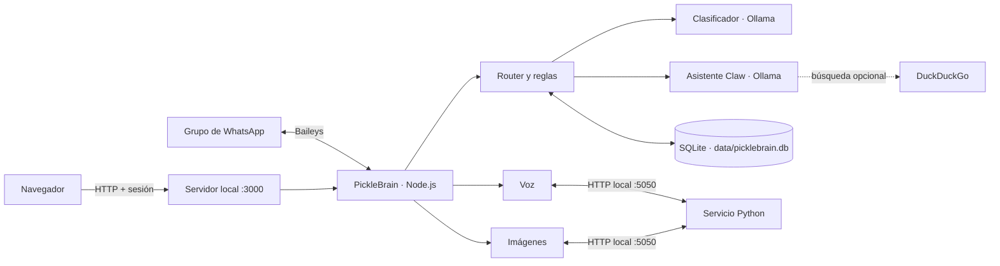

# Arquitectura

Claw son tres piezas que pueden correr en el mismo ordenador:

1. **PickleBrain** (`npm start`): proceso Node.js que mantiene la sesión de WhatsApp, decide qué hacer con cada mensaje, habla con Ollama y guarda todo en SQLite.
2. **Servicio Python** (`npm run ia`, opcional): FastAPI en `127.0.0.1:5050` que transcribe audio con faster-whisper y genera imágenes con diffusers.
3. **Web local**: la sirve el propio PickleBrain en `127.0.0.1:3000`. No hay hosting externo: si el ordenador está apagado, la web no tiene IA ni datos.

## Módulos

| Archivo | Responsabilidad |
| --- | --- |
| `src/index.js` | Arranque completo: base de datos, ajustes, servidor, WhatsApp, limpieza y tareas periódicas |
| `src/web.js` | Arranque solo de la API y la web, sin WhatsApp |
| `src/config.js` | Lectura de `.env` (sin dependencias), normalización de JIDs y valores por defecto |
| `src/settings.js` | Ajustes dinámicos: catálogo, valores de fábrica y aplicación en caliente sobre `config` |
| `src/whatsapp.js` | Sesión de Baileys, reconexión, eventos y envío de mensajes |
| `src/router.js` | Decide qué se hace con cada mensaje: reglas, permisos, comandos y menciones |
| `src/brain.js` | Clasificador que convierte un mensaje en datos estructurados (deberes/exámenes) |
| `src/claw.js` | Asistente conversacional, personalidades y contexto |
| `src/memory.js` | Esquema SQLite y todas las operaciones de persistencia |
| `src/replies.js`, `src/commands.js`, `src/i18n.js` | Textos, alias de comandos y traducciones |
| `src/dates.js`, `src/subjects.js`, `src/signals.js` | Fechas en español, asignaturas y detección rápida por palabras |
| `src/media.js`, `src/transcribe.js`, `src/imagegen.js` | Archivos, voz e imágenes |
| `src/python-ai.js` | Cliente del servicio Python (salud, transcripción, generación) |
| `src/server.js`, `src/web-auth.js` | HTTP, API, CORS y acceso con correo institucional |
| `src/admins.js`, `src/identities.js`, `src/presence.js`, `src/power.js` | Dueño y administradores, alias de JID, «escribiendo…» y bloqueo de suspensión |
| `src/reminders.js`, `src/summary.js`, `src/changelog.js`, `src/chess.js` | Recordatorios, resumen semanal, novedades y ajedrez |
| `python/server.py` | Servicio FastAPI de voz e imágenes |

## Arranque (`npm start`)

En orden, `src/index.js`:

1. Abre SQLite (`memory.init()`), crea tablas e índices y limpia mensajes viejos.
2. Aplica los ajustes guardados sobre `config` (`ajustes.aplicarTodos()`).
3. Reinicia el estado transitorio: las preguntas abiertas de la ejecución anterior no se arrastran.
4. Prepara `data/media` y arranca el servidor HTTP.
5. Ejecuta el primer arranque de idioma: hasta que no se elige idioma no se conecta a WhatsApp.
6. Activa el candado de energía (evita que el ordenador se duerma mientras el bot está abierto).
7. Comprueba Ollama y avisa si el modelo configurado no está descargado.
8. Programa la limpieza automática y arranca Baileys.
9. Al conectar: novedades, recordatorios de exámenes y resumen semanal; luego cada 10 minutos.

## Recorrido de un mensaje

1. `whatsapp.js` recibe el evento, extrae el texto y describe el adjunto si lo hay.
2. `router.js` aplica las reglas: grupo vinculado, permisos, comandos, menciones y modo mantenimiento. Los mensajes normales se ignoran en silencio.
3. Las preguntas de deberes o exámenes que ya están en la base se responden directamente con SQLite.
4. Los mensajes que pueden contener información escolar pasan a `brain.js`, que pide a Ollama un JSON con tipo, asignatura, contenido, fecha y confianza. Las fechas relativas las resuelve `dates.js`.
5. `memory.js` guarda el apunte, abre o cierra preguntas pendientes y, si `STORE_MESSAGES` está activo, una ventana de mensajes recientes.
6. Si alguien invoca a Claw, `claw.js` monta la respuesta con el prompt de la personalidad, la fecha, los apuntes relacionados (solo si la pregunta va de eso) y los mensajes recientes.
7. `whatsapp.js` envía la respuesta al chat.

### Preguntas pendientes

Una pregunta escolar abre una ventana de `ANSWER_WINDOW_MINUTES` (15 por defecto). Si alguien contesta dentro de ese plazo, el router puede interpretar la respuesta como dato y guardarla. Una rectificación explícita sustituye el apunte anterior en vez de duplicarlo: `entries.superseded_by` apunta al nuevo.

### Modo Claw

La palabra clave (`CLAW_TRIGGER`, por defecto `claw`) activa el asistente general. `signals.js` decide rápido si la pregunta es escolar, `claw.js` monta el contexto y `ollama.js` hace la llamada. Los mensajes de grupo se tratan como citas, nunca como instrucciones para el modelo.

## Estado en memoria

El router guarda en memoria lo que no necesita base de datos: grupos vinculados en la ejecución, firmas de la última respuesta, contadores de ritmo por chat y preguntas abiertas. `resetTransientState()` limpia todo al arrancar para no arrastrar restos de la sesión anterior.
